# CLAIM

[](https://ieeexplore.ieee.org/xpl/RecentIssue.jsp?punumber=34)
[](https://www.python.org/)
[](https://pytorch.org/)
[](LICENSE)

**CLAIM** (Content-modulated Low-rank Adaptive Isotropic Mixer) is a sequence block for time series classification when labeled data are scarce. It builds a mixing matrix from the input, keeps that matrix low-rank, and lets three scalars decide how local, how causal, and how translation-invariant the block should be.

The manuscript is submitted to IEEE Transactions on Pattern Analysis and Machine Intelligence. A DOI will replace this note when the paper is published.

Three loops show the shape of the block. The figure after them follows one series through the matrices.

<p align="center">
  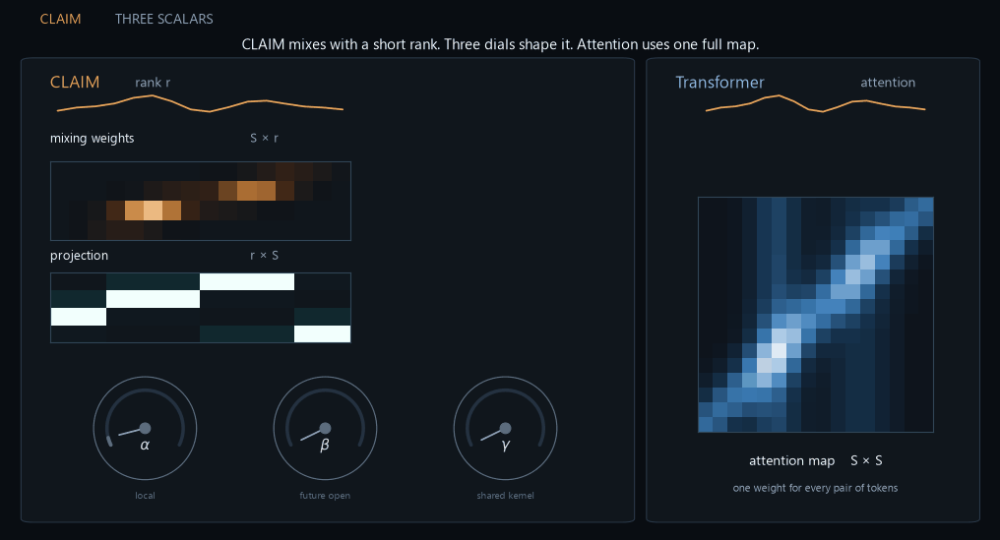
</p>

<p align="center"><i>CLAIM, on the left, mixes the series with weights of shape S × r. The dials are the three scalars. α sets the width of each unit's field, β sets how strongly the future is kept, and γ sets the balance between one shared kernel and independent weights. The Transformer, on the right, mixes through an attention map of shape S × S.</i></p>

<p align="center">
  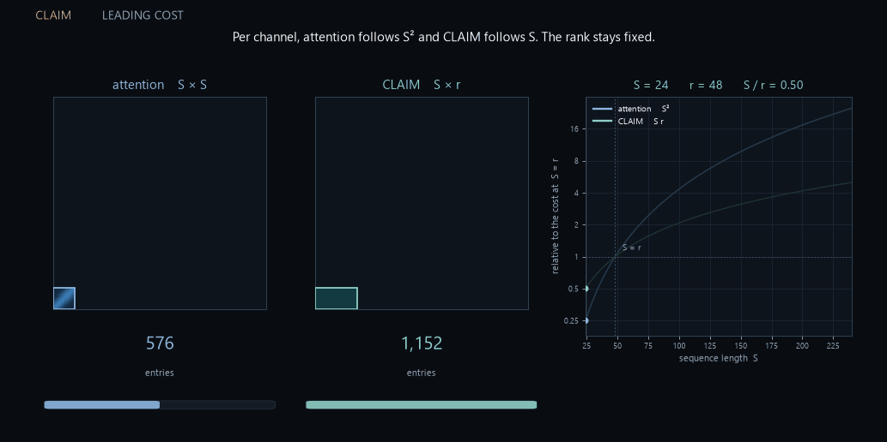
</p>

<p align="center"><i>Leading term per channel, with the rank fixed at 48. CLAIM grows in proportion to the length. Attention grows with the square of the length. The matrices share one scale, so their areas are the number of entries. The curves meet when the length equals the rank. An MLP-Mixer grows in proportion to the length as well, through two MLPs.</i></p>

<p align="center">
  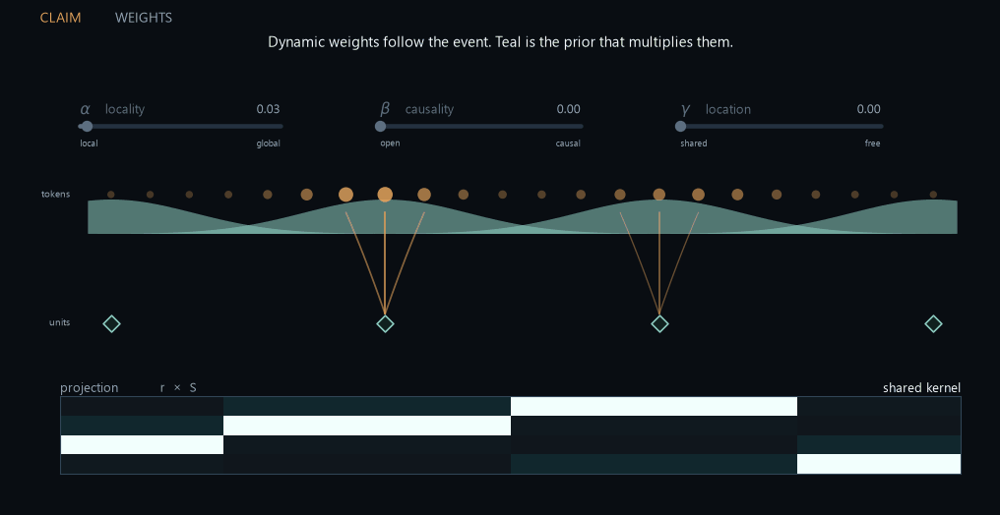
</p>

<p align="center"><i>Amber arcs are dynamic weights that have passed the mask, and they are large where the input carries the event. Teal is the prior. α widens it from each unit's center, and β fades the part after that center. The strip along the bottom is the projection. γ carries it from a shifted kernel to independent weights.</i></p>

<p align="center">
  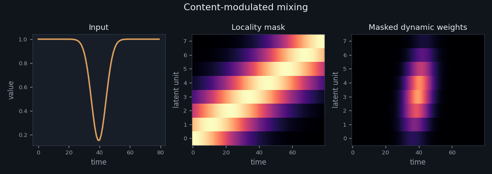
</p>

<p align="center"><i>One pass through a CLAIM block. The diagram stays in view, and each part lights up as its matrices appear. The series is arranged as an S×C matrix and multiplied by a small learnable C×r matrix. The product is a set of dynamic mixing weights, S×r rather than an S×S attention map. Locality and causality regulate those weights, the masked weights mix tokens, and a projection returns the sequence to its original shape. A residual adds the input back.</i></p>

## The block

A block reads one sequence \(X \in \mathbb{R}^{S \times C}\) and returns a sequence of the same shape. \(S\) is the length and \(C\) is the channel width. The rank \(r\) is the number of latent units. Layer normalization is applied on the channel axis:

\[
\tilde{X} = \mathrm{LN}(X).
\]

The input then produces its own mixing weights. With \(P_1 \in \mathbb{R}^{C \times r}\),

\[
W_{\mathrm{dyn}} = \tilde{X} P_1, \qquad W_{\mathrm{dyn}} \in \mathbb{R}^{S \times r}.
\]

Row \(i\) of \(W_{\mathrm{dyn}}\) is the content of token \(i\), one coefficient per latent unit. There is no \(S \times S\) attention map. The tokens are mixed by those coefficients,

\[
Z = \tilde{X}^{\top} W_{\mathrm{dyn}}, \qquad Z \in \mathbb{R}^{C \times r},
\]

and a second matrix \(P_2 \in \mathbb{R}^{r \times S}\) sends the result back to the original length. \(b \in \mathbb{R}^{S}\) is a bias. A GELU and a residual close the block:

\[
Y = X + \mathrm{GELU}\!\left((Z P_2 + b)^{\top}\right).
\]

That is the base block. The full block multiplies \(W_{\mathrm{dyn}}\) by a mask and replaces \(P_2\) with an interpolation, as the next three sections describe. Stacking does not change the shape, which is what *isotropic* means here.

<p align="center">
  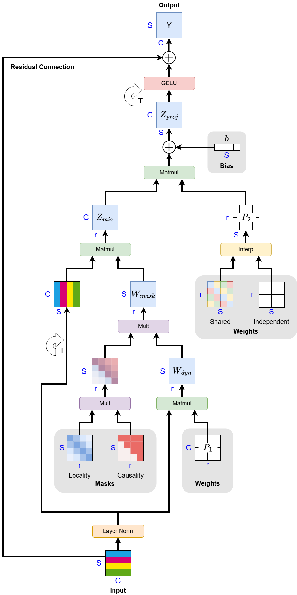
</p>

<p align="center"><i>The full block. Grey tensors are parameters. The mask is an element-wise product, and the projection interpolates a shared kernel with independent weights.</i></p>

## Three scalars

Each scalar is a single parameter per block. The sigmoid maps it to \((0, 1)\).

\[
\sigma(u) = \frac{1}{1 + e^{-u}}.
\]

### Locality, \(\alpha\)

Latent unit \(j\) sits at a fixed center

\[
\mu_j = j \cdot \frac{S - 1}{r - 1}, \qquad j = 0, \ldots, r - 1.
\]

The spread is shared by every unit and grows with the length of the series:

\[
\sigma_{\alpha} = 3\, S\, \sigma(\alpha).
\]

The locality mask is a Gaussian of that spread:

\[
L_{ij} = \exp\!\left(-\frac{(i - \mu_j)^2}{2\sigma_{\alpha}^2}\right).
\]

\(\sigma(\alpha) \to 0\) makes each unit read only the tokens next to its center. \(\sigma(\alpha) \to 1\) makes \(\sigma_{\alpha} = 3S\). The weight on the farthest token is then about \(0.95\) for a long series, so the mask is almost flat and the block mixes globally. The constant \(3\) is what produces that limit: \(\exp(-1/(2 \cdot 3^2)) \approx 0.946\).

<p align="center">
  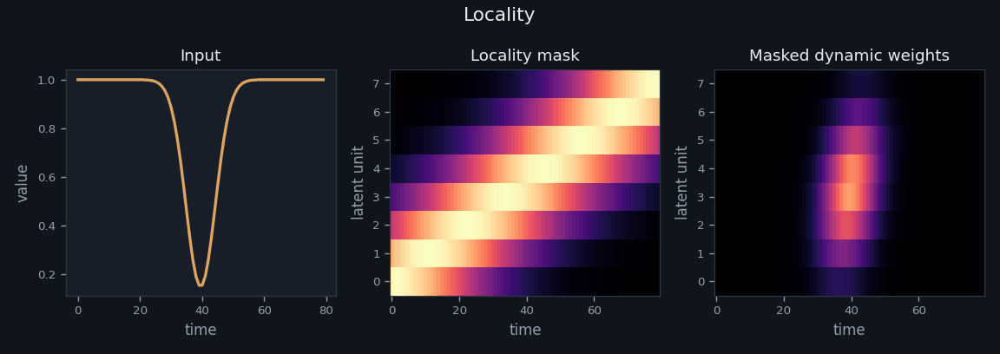
</p>

<p align="center"><i>Each latent unit keeps a Gaussian receptive field. As α changes, the field widens and narrows, and the content weights remain only where the field is high.</i></p>

The exact Gaussian is the default. `--locality lookup` stores the same family of masks at ten spreads placed uniformly from \(0\) to \(3S\), and interpolates the two nearest masks from \(\sigma(\alpha)\). The grid does not depend on the dataset. This is a training optimization: the forward pass no longer evaluates an exponential at every entry. The endpoints of the grid match the exact mask.

### Causality, \(\beta\)

The present token of unit \(j\) is the token nearest its center, \(s_j = \mathrm{round}(\mu_j)\). Tokens up to that index are left alone. Later tokens are scaled by one factor,

\[
\phi = \sigma(\beta), \qquad
C_{ij} =
\begin{cases}
1 & \text{if } i \le s_j, \\
1 - \phi & \text{if } i > s_j.
\end{cases}
\]

\(\phi \to 1\) is strictly causal. \(\phi \to 0\) leaves the future visible. The two masks are multiplied:

\[
M = L \odot C, \qquad W_{\mathrm{mask}} = M \odot W_{\mathrm{dyn}}.
\]

<p align="center">
  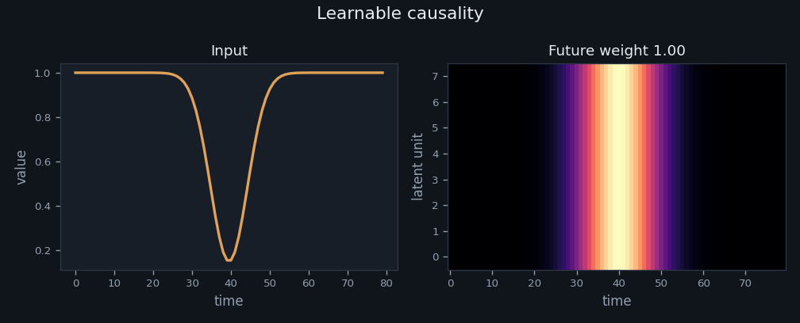
</p>

<p align="center"><i>The same content weights as the future is turned down. Each latent unit cuts at its own present token.</i></p>

### Location invariance, \(\gamma\)

The map back to the sequence uses a kernel of \(r\) weights, one per latent unit, shared by every output time:

\[
w_{\mathrm{shared}} \in \mathbb{R}^{r}.
\]

Output time \(t\) reads a circular shift of that kernel. The shift lines a reference unit up with \(t\), using the same spacing as the centers above. Independent weights \(W_{\mathrm{indep}} \in \mathbb{R}^{S \times r}\) have no such tie. A gate mixes them:

\[
\lambda = \sigma(\gamma), \qquad
P_2^{\top} = \lambda W_{\mathrm{indep}} + (1 - \lambda)\, W_{\mathrm{shared}}.
\]

\(\lambda \to 0\) is the convolutional case: every output time applies the same kernel. \(\lambda \to 1\) gives each output time its own weights. The base block is this second case with the mask removed.

<p align="center">
  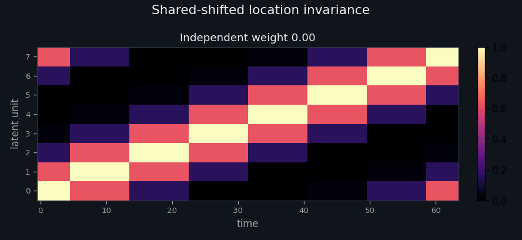
</p>

<p align="center"><i>Left, one kernel shifted along the sequence. The frames move the gate toward independent weights.</i></p>

## The full equation

With \(M\) and \(P_2^{\mathrm{loc}}\) from the three scalars,

\[
Y = X + \mathrm{GELU}\!\left(\big(\tilde{X}^{\top}(M \odot (\tilde{X} P_1))\big)\, P_2^{\mathrm{loc}} + b\right)^{\top}.
\]

Three variants are trained in the paper.

| Variant | Mask | Projection | Flag |
| --- | --- | --- | --- |
| Full | locality and causality | shared kernel interpolated with independent weights | `--variant full` |
| Location invariance | none | the same interpolation | `--variant location-invariance` |
| Base | none | independent weights only | `--variant base` |

Centers, distances and shift indices are buffers. They are filled once when the block is created. During training the only adaptive work is the Gaussian (or the lookup), the future scale, and the interpolation. At inference those three scalars are constant, so `fold_inference` writes the mask and \(P_2\) into buffers. The forward pass that remains is the three matrix products, the bias, the GELU and the residual.

The leading cost of one block is \(O(SCr)\) from those products. The mask adds \(O(Sr)\). There is no \(S^2\) term. A Transformer encoder pays \(O(CS^2)\) for its attention map. An MLP-Mixer block is also linear in \(S\), through two MLPs rather than one low-rank product.

## The network

<p align="center">
  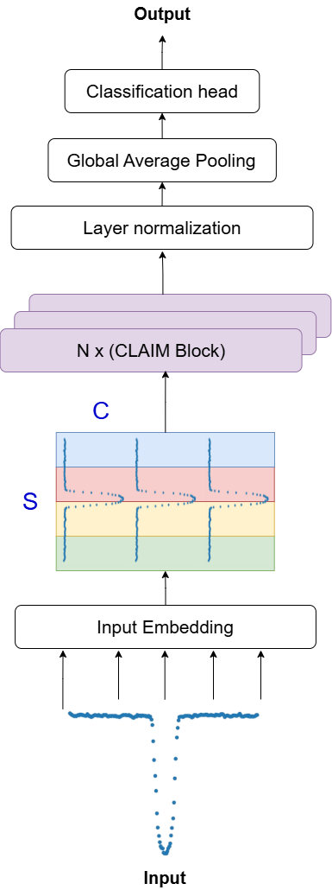
</p>

<p align="center"><i>The classifier. Medical series use a linear embedding. Kepler and TESS use two convolutions of kernel size 3 with batch normalization. Every column keeps its length. A shared layer norm, a mean over time, and a linear head produce the class logits.</i></p>

Kepler has two columns, a global view of 2,001 bins and a local view of 201. TESS has three: global 201, local 61, secondary 61, plus the scalar depth change concatenated after pooling. ECG200 and the ICU series have one column. The two baselines use the same columns and the same embedding. The Temporal Transformer adds fixed sinusoids, post-norm encoder layers and dropout 0.1. On Kepler its global view is resampled to 1,000 bins, which is the length that fit in GPU memory, and its batch size is 8. CLAIM and MLP-Mixer keep all 2,001 bins.

The published widths are:

|  | Blocks | Embedding width | Rank, or Transformer width |
| --- | ---: | ---: | --- |
| ECG200 | 4 | 48 | 70. Transformer MLP 140, 5 heads |
| Kepler | 3 per view | 48 | global 96, local 48 |
| TESS | 2 per view | 32 | global 32, local 16, secondary 16 |
| ICU | 2 | 32 | 16. Transformer MLP 32, 4 heads |

MLP-Mixer uses those ranks as the width of both the token MLP and the channel MLP. Optimizer, schedule and loss are in the appendix of the manuscript and in `claim.published`. Every run clips gradients at norm 1. Early stopping restores the weights with the best validation accuracy. The ICU schedule has no validation split: each monthly model trains for 100 epochs.

## What the study measured

Ten repetitions, mean ± standard deviation. Accuracy and AUC are percentages. The best entry in each column is in bold. CLAIM is the full block.

| Dataset | CLAIM acc. | Mixer acc. | Transf. acc. | CLAIM AUC | Mixer AUC | Transf. AUC |
| --- | ---: | ---: | ---: | ---: | ---: | ---: |
| AMG | 71.58 ± 1.21 | 74.03 ± 0.89 | **80.53 ± 0.33** | 69.87 ± 4.57 | 70.95 ± 2.13 | **81.34 ± 1.63** |
| CAR | **78.77 ± 2.60** | 76.84 ± 2.65 | 75.79 ± 1.33 | 69.63 ± 6.68 | **74.64 ± 2.13** | 72.24 ± 3.32 |
| CF4 | 56.51 ± 1.25 | 50.70 ± 1.65 | **65.11 ± 1.63** | 60.52 ± 2.27 | 51.17 ± 1.99 | **68.96 ± 0.97** |
| PAP | **67.97 ± 3.19** | 53.47 ± 2.30 | 66.67 ± 0.00 | **71.76 ± 1.80** | 57.05 ± 2.45 | 69.67 ± 0.41 |
| POL | **58.87 ± 2.63** | 55.91 ± 1.02 | 48.93 ± 0.34 | **48.08 ± 3.12** | 39.92 ± 4.59 | 35.03 ± 0.35 |
| QUI | **81.82 ± 1.00** | 76.97 ± 2.30 | 75.46 ± 2.88 | **91.47 ± 1.65** | 86.93 ± 3.23 | 84.80 ± 0.76 |
| Kepler | **94.94 ± 0.41** | 90.64 ± 0.39 | 92.91 ± 0.04 | **98.33 ± 0.07** | 95.16 ± 0.43 | 96.77 ± 0.22 |
| TESS | **91.70 ± 0.83** | 84.72 ± 0.46 | 88.23 ± 1.19 | **95.68 ± 0.67** | 95.06 ± 0.02 | 94.73 ± 0.28 |
| ECG200 | **81.67 ± 1.78** | 80.43 ± 1.54 | 69.11 ± 1.02 | **89.38 ± 0.70** | 88.09 ± 0.66 | 67.81 ± 2.30 |

CLAIM has the lowest inference time of the three on every dataset. It also has the fewest parameters except on Kepler, where \(P_2\) grows with the 2,001-bin global view and the Transformer, on a shorter view, is smaller (313,778 parameters against 641,282). Representative counts:

|  | CLAIM | MLP-Mixer | Temporal Transformer |
| --- | ---: | ---: | ---: |
| AMG | 3,524 | 5,726 | 5,226 |
| Kepler | 641,282 | 1,268,528 | 313,778 |
| TESS | 27,356 | 48,906 | 30,948 |
| ECG200 | 41,670 | 82,834 | 162,717 |

The base block is already competitive. Locality, causality and the shared kernel improve the scores on several sets and add training time. Folding them at inference leaves the inference time essentially unchanged.

## Where the weights land

The dynamic weights of the first block are largest where the label is decided.

<p align="center">
  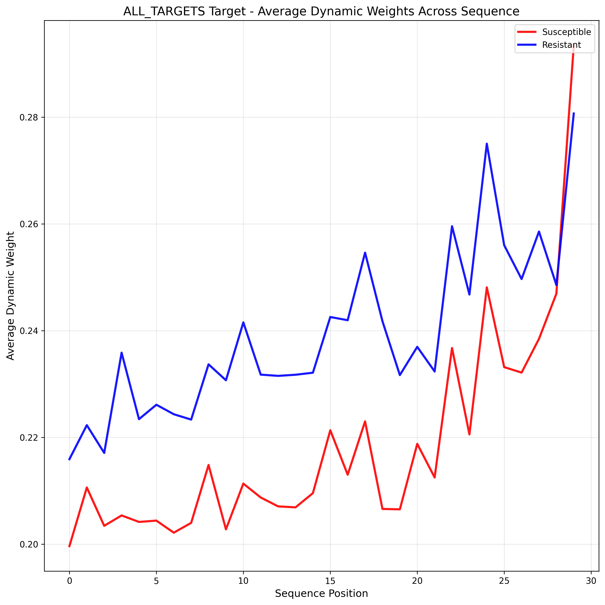
</p>

<p align="center"><i>ICU. The culture is the last day of the window. The weights rise toward that day. Curves are the mean absolute weight over the latent units, for resistant and susceptible cultures.</i></p>

<p align="center">
  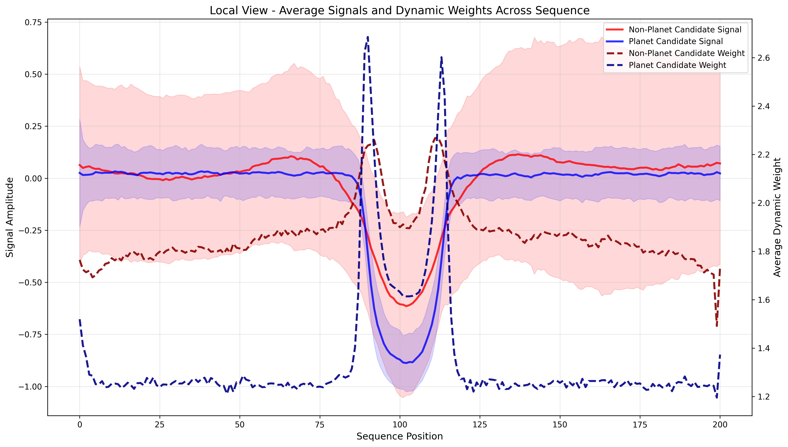
  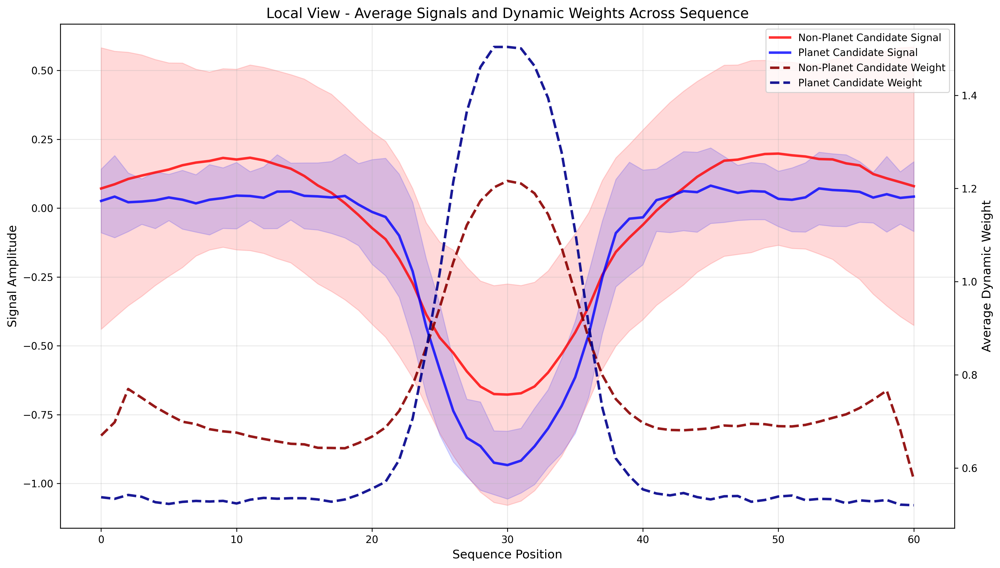
</p>

<p align="center"><i>Kepler and TESS, local view. The weights sit on the transit, which is the center of the binned view. Planet candidates and non-planet candidates are drawn separately, with the mean light curve behind them.</i></p>

<p align="center">
  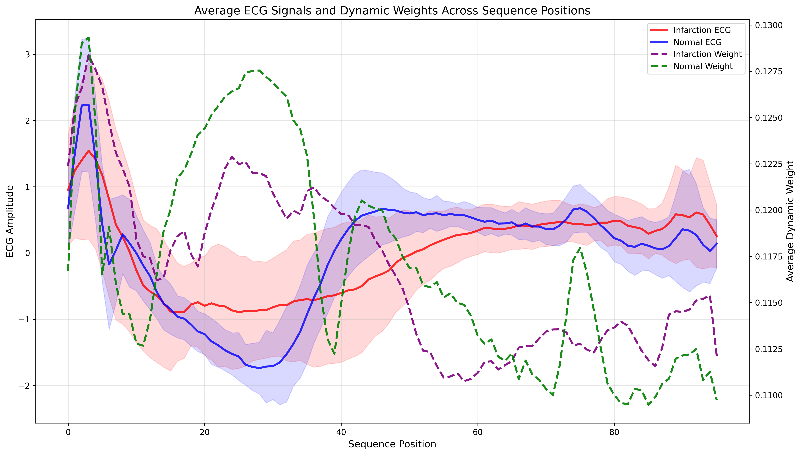
</p>

<p align="center"><i>ECG200. The weights sit on the early part of the beat, around the QRS complex.</i></p>

<p align="center">
  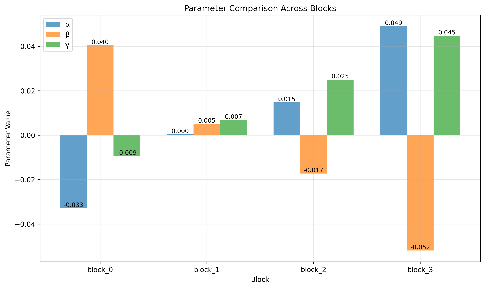
</p>

<p align="center"><i>ECG200, mean of <b>α</b>, <b>β</b> and <b>γ</b> across the five folds. Early blocks use a tighter mask. Later blocks open it.</i></p>

## Data

The hospital extract is not in this repository. The ICU command builds a synthetic cohort with the same layout: 30 days, the six family widths (36, 18, 67, 24, 55 and 49 features), an expanding train and a one-month test from January 2016, and the temporal weight \(e^{-\lambda \Delta t}\) with \(\lambda = 10^{-5}\). Recent days carry the label signal. The names of the selected columns from the public feature list are in `data/icu/features/`. The synthetic metrics are not the table above.

The other three sets are the arrays used for the paper.

|  | Series | Split |
| --- | --- | --- |
| ECG200 | 200 beats, 96 samples, one channel | the UCR train file (100) and test file (100). Five folds of the train file, official test held out |
| Kepler | 15,737 light curves, 3,600 planet candidates. Global 2,001, local 201 | 80/10/10 with `random.seed(42)`: 12,589 / 1,573 / 1,575 rows and 2,875 / 338 / 387 planet candidates |
| TESS | 14,480 light curves. Global 201, local 61, secondary 61, one depth scalar | the stored split, 11,573 / 1,465 / 1,442, with 349 / 57 / 48 planet candidates |

ECG200 is the UCR archive series of Olszewski. Kepler labels are the Autovetter catalog for Q1–Q17 DR24 ([10.26133/NEA15](https://doi.org/10.26133/NEA15)); the light curves are from MAST ([10.17909/T9488N](https://doi.org/10.17909/T9488N)), binned as in Shallue and Vanderburg. TESS labels follow the Astronet vetting catalog, and the light curves are the QLP products ([10.17909/t9-r086-e880](https://doi.org/10.17909/t9-r086-e880)) together with the TESS bulk light curves ([10.17909/t9-nmc8-f686](https://doi.org/10.17909/t9-nmc8-f686)). Kepler is stored as two compressed shards because a single file would pass GitHub's limit. The loader concatenates `part-*.npz` in order.

## Running

```bash
pip install -e .
python -m claim
```

The bare command is a smoke run: a generated ECG-sized cohort, the full block, one epoch. It does not read `data/` and its scores are not the table.

```bash
python -m claim --paper --dataset ecg200
python -m claim --paper --dataset kepler --model claim
python -m claim --paper --dataset tess --model mixer
python -m claim --paper --dataset icu --family qui
python -m claim --paper --dataset ecg200 --locality lookup
python -m claim --paper --dataset kepler --variant base --repetitions 1 --epochs 2
```

`--paper` selects the published width, schedule and ten repetitions. `--model` is `claim`, `mixer` or `transformer`. `--variant` is the ablation, and it applies to CLAIM. `--locality lookup` switches on the shared ten-mask grid. `--epochs`, `--batch-size` and `--learning-rate` replace the schedule. `--seed` is the first repetition; the next ones use `seed + 1`, `seed + 2`, and so on. Metrics are written to `outputs/metrics.txt`.

On the GTX 1650 Ti used for the paper, one Kepler epoch of CLAIM took about half a minute and one TESS epoch a similar time, so ten full repetitions are a long run. ECG200 is five folds of up to 1,000 epochs. The ICU command repeats that protocol on the synthetic cohort, one model per test month.

While a run is in progress the console keeps a single updating line per stage:

```text
kepler  claim  full
  device cuda  repetitions 10  epochs 300  batch 64

kepler
  run 1            [######--------------] 84/300  val 0.941
```

## Layout

```text
src/claim/block.py        the block, the lookup and inference folding
src/claim/models.py       CLAIM, MLP-Mixer and the Temporal Transformer
src/claim/published.py    widths and schedules from the manuscript
src/claim/data.py         ECG200, Kepler, TESS and the monthly ICU windows
src/claim/synthetic.py    generated cohorts
src/claim/training.py     the loop, early stopping and the metrics
src/claim/run.py          the command line
data/                     the public arrays and the ICU column names
docs/figures/             the diagrams, the animations and the weight plots
```

## Citation

Hernández-Carnerero, À., Sànchez-Marrè, M., and Vázquez-Salceda, J. CLAIM: A general-purpose Content-modulated Low-rank Adaptive Isotropic Mixer for limited-data Time Series Classification. Submitted to IEEE Transactions on Pattern Analysis and Machine Intelligence, 2026.

```bibtex
@article{hernandez2026claim,
  title   = {CLAIM: A general-purpose Content-modulated Low-rank Adaptive Isotropic Mixer for limited-data Time Series Classification},
  author  = {Hern{\'a}ndez-Carnerero, {\`A}lvar and S{\`a}nchez-Marr{\`e}, Miquel and V{\'a}zquez-Salceda, Javier},
  journal = {IEEE Transactions on Pattern Analysis and Machine Intelligence},
  year    = {2026},
  note    = {Submitted}
}
```

The code is MIT. The manuscript remains with the authors until publication.
